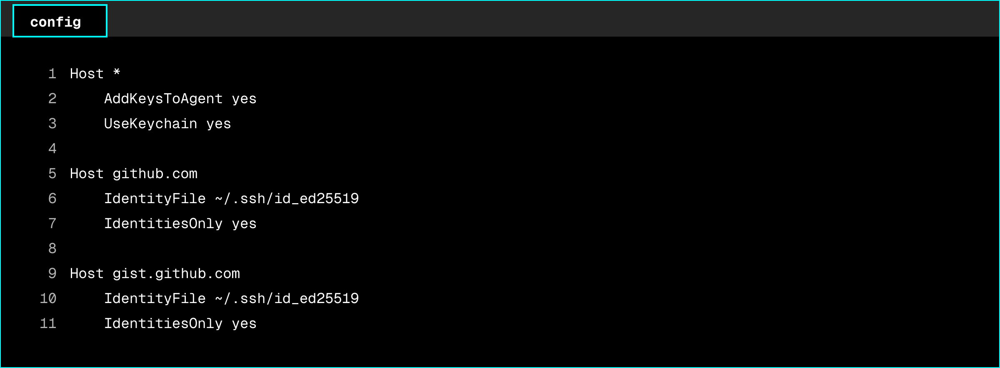

# ssh-config

This repository's SSH configuration has moved to the `git/ssh` folder of the dotfiles repository, where it is maintained together with the rest of the developer setup. Changes and issues are handled there.

[Open git/ssh in dotfiles](https://github.com/zaccesss/dotfiles/tree/main/git/ssh)

> [!NOTE]
> This repository is archived and read-only.

